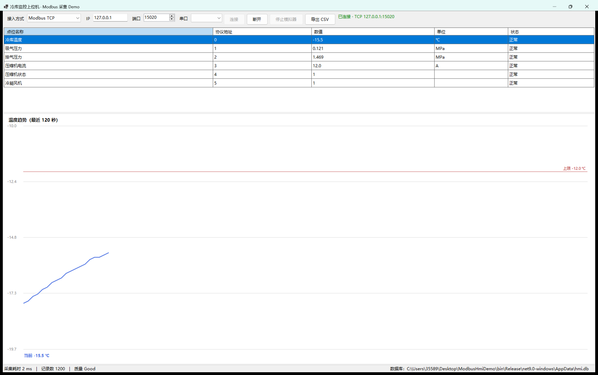

# Modbus 上位机 Demo（C# / WinForms）

一个可以直接运行的**工业设备监控上位机**示例：通过 **Modbus TCP / RTU** 采集设备寄存器，实时刷新点位表与趋势曲线，超限报警，数据落库 SQLite，支持 CSV 导出。
**内置 Modbus TCP 从站模拟器，没有 PLC 也能完整跑通。**



## 功能

- **两种接入方式**：Modbus TCP 与 Modbus RTU（串口），共用同一套协议解析，`IModbusClient` 一套接口两个实现
- **功能码 03 / 06**：读保持寄存器、写单个寄存器，帧自行拼装，不依赖第三方协议库
- **内置从站模拟器**：本机监听 `127.0.0.1:15020`，按正弦曲线生成 6 个点位，含偶发超限
- **采集调度**：1 秒轮询、超时与断线处理、采集质量标记（Good / Alarm / Bad）、防重入
- **数据存储**：SQLite（WAL 模式），一次采集写入同一事务；支持历史查询与 CSV 导出
- **界面**：点位表实时刷新、GDI+ 自绘趋势曲线、超限行高亮、状态栏显示采集耗时与记录数
- **无界面自检**：`--selftest` 验证协议收发与存储，不弹窗
- **防误操作**：连接期间“停止模拟器”按钮自动禁用，避免采集中途设备消失
- **异常兜底**：未捕获异常写入 `AppData/crash.log` 并弹窗提示，不会无提示退出

## 快速开始

环境：Windows 10/11 + [.NET 9 SDK](https://dotnet.microsoft.com/download/dotnet/9.0)

```powershell
git clone https://github.com/qinyansu/ModbusHmiDemo.git
cd ModbusHmiDemo
dotnet run -c Release
```

操作顺序：点 **启动模拟器** → 点 **连接** → 表格每秒刷新、下方开始画曲线。

> 连接期间“停止模拟器”会被禁用：要停设备，先点 **断开**。这样能避免采集到一半设备消失导致的一屏报错。

一键演示（自动开模拟器 + 自动连接）：

```powershell
.\bin\Release\net9.0-windows\ModbusHmiDemo.exe --demo
```

无界面自检：

```powershell
.\bin\Release\net9.0-windows\ModbusHmiDemo.exe --selftest
type .\bin\Release\net9.0-windows\selftest.txt
```

## 数据存在哪

跑起来后，数据写在 **exe 同目录的 AppData** 下（不是源码目录）：

```
bin/Release/net9.0-windows/AppData/hmi.db      ← 主库
bin/Release/net9.0-windows/AppData/hmi.db-wal  ← 预写日志（运行中）
bin/Release/net9.0-windows/AppData/hmi.db-shm  ← 共享内存索引（运行中）
```

- 用的是 **WAL 模式**：新数据先写 `-wal`，正常退出时才合并回 `hmi.db`；
- 备份要三个文件一起拷，或先关程序；
- 每次运行都是**追加**，不会覆盖。6 点位 × 1 Hz ≈ 每小时 2.16 万行，暂时没有自动清理（见路线图）。

用 [DB Browser for SQLite](https://sqlitebrowser.org/) 打开 `hmi.db` 即可浏览。

## 出问题先看这里

程序不会“无声消失”：任何未捕获异常都会弹窗，并写日志到

```
bin/Release/net9.0-windows/AppData/crash.log
```

常见提示：

| 提示 | 原因 |
|---|---|
| 连接失败：连接超时 | 没点“启动模拟器”，或端口被占用 |
| 通信异常：设备已断开 | 对端连接被关闭（例如停止过模拟器） |
| 启动失败：端口被占用 | 已有另一个实例占着 15020 |

## 项目结构

| 文件 | 职责 |
|---|---|
| `Modbus.cs` | `IModbusClient` 接口、CRC16、TCP 客户端、RTU 客户端 |
| `Points.cs` | 点表：地址、工程量换算、报警阈值 |
| `Simulator.cs` | Modbus TCP 从站模拟器（功能码 03 / 06） |
| `Store.cs` | SQLite 建表、事务写入、历史查询、CSV 导出 |
| `MainForm.cs` | 界面与采集调度；文件末尾含自绘趋势控件 `TrendPanel` |
| `Program.cs` | 入口，`--demo` / `--selftest` |
| `docs/modbus_min.py` | 20 行手写 Modbus TCP 帧的教学脚本，不依赖任何库 |

## 协议要点

**请求帧（读 6 个保持寄存器，从站 1，起始地址 0）**

```
00 01 | 00 00 | 00 06 | 01 | 03 | 00 00 | 00 06
事务号  协议号   长度   单元  功能码 起始地址  数量
```

**响应帧**

```
00 01 | 00 00 | 00 0F | 01 | 03 | 0C | [12 字节数据]
                           ↑    ↑
                        功能码  字节数（6 个寄存器 = 12 字节）
```

- 长度字段 **不含** MBAP 头自身的 7 字节：`1 + 1 + 2 + 2 = 6`
- 异常响应：功能码最高位置 1（`0x83`），后跟异常码（`0x02` = 地址非法）
- RTU 帧无 MBAP 头，改为 `从站地址 + PDU + CRC16`，CRC 低字节在前

## 关键实现

| 问题 | 做法 |
|---|---|
| **粘包** | 先读 6 字节帧头取长度，再按长度读满，不假设一次 `Read` 读完 |
| **字节序** | 两个字节拼 `ushort` 时高字节在前；温度用 `short` 解析才能读负数 |
| **地址偏移** | 手册写 40001，协议传 0，相差 1 |
| **批量写入** | 一次采集的 6 个点放在同一事务，避免每秒 6 次磁盘提交 |
| **UI 更新** | 定时器在 UI 线程触发，`await Task.Run(读)` 后回到 UI 线程，无需 `Invoke` |
| **重入保护** | `_busy` 标志，上一轮未完成时跳过本轮 |

## 已知限制

- RTU 分支已实现 CRC16 与帧解析，但**未在真实串口设备上验证**，可用 com0com 虚拟串口对联调；
- 模拟器只监听回环地址，不对外开端口；
- 无用户权限、无设备联锁，属于学习/演示项目，不是生产软件。

## 路线图

- [ ] 报警记录页（发生 / 确认 / 恢复三段状态）
- [ ] 历史查询页（按时间范围查曲线、分页表格）
- [ ] 点表改为 JSON 配置，界面可增删点位
- [ ] 写值控制（功能码 06）与二次确认
- [ ] NLog 日志与断线自动重连
- [ ] 历史数据自动归档（按天数或体积清理）

## 许可

[MIT](LICENSE)
